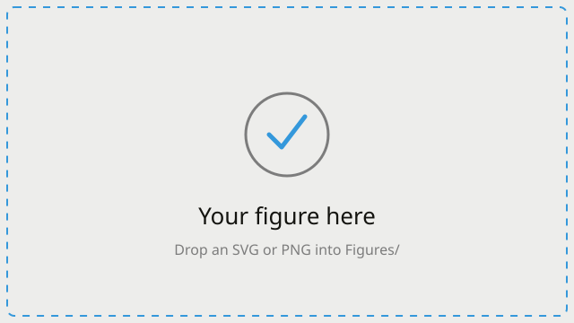

## A section divider {.center}

::: {.visually-hidden}
Section: example divider
:::

::: {style="text-align: center; padding-top: 1em;"}
Use `## Title {.center}` for a vertically centered divider slide.
:::

## Bullets and emphasis

- Lists inherit tight, readable spacing from the theme.
- Use [`.accent`]{.accent} for brand-blue emphasis and [`.accent-pink`]{.accent-pink} sparingly.
- Keep each bullet to one idea; let the slide breathe.

::: {.key-insight}
**The blue key-insight box is the workhorse callout.** Use it once per slide, at most, for the single thing you want remembered.
:::

## Two columns

::: {.columns}
::: {.column width="52%"}
### Left column

- Columns use Quarto's native `::: {.columns}` / `::: {.column width="…"}`.
- Widths are percentages; leave a little slack so they don't collide.
:::
::: {.column width="44%"}
### Right column

Put a figure, a callout, or supporting text here. Add `.v-center-cols` on the
slide to vertically center the two columns against each other.
:::
:::

## Titled callout boxes

::: {.theorem-box}
::: {.theorem-box-title}
Definition / Theorem (orange)
:::
Use the orange box for formal statements — definitions, theorems, claims you
will defend.
:::

::: {.key-insight-box}
::: {.key-insight-box-title}
Emphasis (violet)
:::
Use the violet box for a second, visually distinct emphasis when one blue box
isn't enough.
:::

::: {.warning-box}
::: {.warning-box-title}
Caution (red)
:::
Use the red box for risks, failure modes, and cautions.
:::

## A single number

::: {.columns}
::: {.column width="33%"}
::: {.stat-callout}
::: {.stat-number}
966
:::
::: {.stat-label}
example conditions
:::
:::
:::
::: {.column width="33%"}
::: {.stat-callout}
::: {.stat-number}
4×
:::
::: {.stat-label}
faster iteration
:::
:::
:::
::: {.column width="33%"}
::: {.stat-callout}
::: {.stat-number}
1
:::
::: {.stat-label}
human in the loop
:::
:::
:::
:::

## A figure

Drop SVG or PNG figures in `Figures/`. They render centered, get a subtle card
wash, and are click-to-enlarge automatically.

{width="55%" fig-alt="Describe the figure for screen-reader users."}

::: {.notes}
This is a speaker note. Press 'S' in the browser to open the speaker view with
notes and a timer. Notes never appear on the projected slide.
:::

## References {.smaller}

::: {style="font-size: 0.75em; line-height: 1.6;"}

Author, A. (Year). *Title of the work*. Publisher/Journal.

:::
